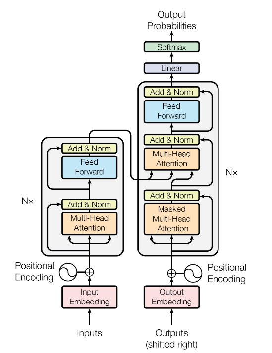

# Transformer From Scratch in PyTorch

An educational implementation of the Transformer architecture using PyTorch, inspired by the paper [Attention Is All You Need](https://arxiv.org/abs/1706.03762) by Vaswani et al. (2017).

## Overview

This project explores the core components of the Transformer architecture through custom PyTorch modules and an interactive Jupyter Notebook.

## Implemented Components
