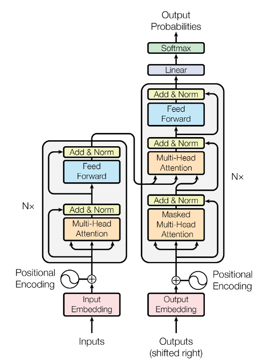

# Transformer From Scratch in PyTorch



An educational implementation of the Transformer architecture using PyTorch, inspired by the paper [Attention Is All You Need](https://arxiv.org/abs/1706.03762) by Vaswani et al. (2017).

## Overview

This project explores the core components of the Transformer architecture through custom PyTorch modules, with an emphasis on understanding the underlying mathematical operations, tensor transformations, attention mechanisms, and interactions between the Encoder and Decoder.

The implementation is built incrementally from individual components, including scaled dot-product attention, multi-head attention, feed-forward networks, positional encoding, and normalization, up to the Encoder–Decoder Transformer Core.

The project also includes unit tests and an interactive Jupyter Notebook for exploring the architecture and its building blocks.

## Implemented Components

### Attention Mechanisms

- **Scaled Dot-Product Self-Attention**
  - Query, Key, and Value projections.
  - Scaled dot-product attention computation.
  - Softmax-based attention weights.

- **Multi-Head Attention**
  - Multiple attention heads with independent projections.
  - Head splitting and concatenation.
  - Scaled dot-product attention.
  - Output projection.
  - Self-Attention and Cross-Attention support.
  - Attention masks (`attn_mask`).
  - Key padding masks (`key_padding_mask`).
  - Combined attention mask validation.

### Transformer Building Blocks

- **Position-wise Feed-Forward Network**
  - Two linear transformations.
  - ReLU and GELU activation support.
  - Dropout.

- **Layer Normalization**
  - Custom implementation of Layer Normalization.
  - Learnable scale and shift parameters.

- **Sinusoidal Positional Encoding**
  - Sine and cosine positional encodings.
  - Non-learnable positional information.
  - Registered buffers for device-aware operations.

### Encoder

- **Encoder Layer**
  - Multi-Head Self-Attention.
  - Position-wise Feed-Forward Network.
  - Residual connections.
  - Layer Normalization.
  - Dropout.
  - Attention mask and key padding mask support.

- **Encoder Stack**
  - Multiple independently parameterized Encoder layers.
  - Sinusoidal Positional Encoding.
  - Source attention mask propagation.
  - Source key padding mask propagation.

### Decoder

- **Decoder Layer**
  - Masked Multi-Head Self-Attention.
  - Encoder–Decoder Cross-Attention.
  - Position-wise Feed-Forward Network.
  - Residual connections.
  - Layer Normalization.
  - Dropout.
  - Target and memory mask support.

- **Decoder Stack**
  - Multiple independently parameterized Decoder layers.
  - Sinusoidal Positional Encoding.
  - Target and memory mask propagation.

### Transformer Core

- Composition of the Encoder and Decoder stacks.
- Encoder output passed to the Decoder as memory.
- Support for source, target, and memory attention masks.
- Support for source, target, and memory key padding masks.
- Batch-first tensor representation.

## Project Scope

The current implementation focuses on the **Transformer Core**, which accepts pre-computed source and target embeddings and returns the Decoder representations.

The following components are not yet implemented:

- Token Embedding layers.
- Embedding scaling.
- Vocabulary projection and output logits.
- Complete training pipeline.
- Autoregressive text generation.
- Model evaluation and benchmarking.

These components are planned for future development.

## Tensor Shape Convention

The implementation uses batch-first tensor representations.

| Tensor | Shape | Description |
|---|---|---|
| Source | `(B, S, D)` | Source embeddings |
| Target | `(B, T, D)` | Target embeddings |
| Encoder output | `(B, S, D)` | Encoded source representations |
| Memory | `(B, S, D)` | Encoder output passed to the Decoder |
| Decoder output | `(B, T, D)` | Final Decoder representations |

Where:

- `B`: Batch size
- `S`: Source sequence length
- `T`: Target sequence length
- `D`: Model dimension (`d_model`)

### Attention Mask Conventions

Boolean masks use the following convention:

- `True`: Block the corresponding attention position.
- `False`: Allow attention to the corresponding position.

Supported masks:

| Mask | Shape | Purpose |
|---|---|---|
| `src_mask` | `(S, S)` | Source attention masking |
| `src_key_padding_mask` | `(B, S)` | Source padding positions |
| `tgt_mask` | `(T, T)` | Target attention masking |
| `tgt_key_padding_mask` | `(B, T)` | Target padding positions |
| `memory_mask` | `(T, S)` | Cross-attention masking |
| `memory_key_padding_mask` | `(B, S)` | Encoder memory padding positions |

For autoregressive decoding, a causal target mask must be supplied to prevent positions from attending to future tokens.

## Installation

This project uses [uv](https://docs.astral.sh/uv/) for Python project and dependency management.

Clone the repository:

```bash
git clone https://github.com/ahmadrezabaqerzade/transformer-from-scratch.git

cd transformer-from-scratch
```

Install the project dependencies:

```bash
uv sync --all-groups
```

## Usage

The current Transformer Core accepts source and target embeddings rather than token IDs.

```python
import torch

from transformer_from_scratch.transformer import Transformer

device = torch.device(
    "cuda" if torch.cuda.is_available() else "cpu"
)

batch_size = 2
src_length = 10
tgt_length = 8
d_model = 32

src = torch.randn(
    batch_size,
    src_length,
    d_model,
    device=device,
)

tgt = torch.randn(
    batch_size,
    tgt_length,
    d_model,
    device=device,
)

model = Transformer(
    d_model=d_model,
    nhead=4,
    num_encoder_layers=2,
    num_decoder_layers=2,
    d_ff=128,
).to(device)

output = model(src=src, tgt=tgt)

print(output.shape)
```

Expected output shape:

```text
torch.Size([2, 8, 32])
```

## Running Tests

Run the test suite using pytest:

```bash
uv run pytest
```

## Project Structure

```text
transformer-from-scratch/
│
├── images/
│   └── transformer-model-architecture.png
│
├── notebooks/
│   └── transformer.ipynb
│
├── src/
│   └── transformer_from_scratch/
│       ├── __init__.py
│       ├── self_attention.py
│       ├── multi_head_attention.py
│       ├── feed_forward.py
│       ├── layer_norm.py
│       ├── positional_encoding.py
│       ├── encoder_layer.py
│       ├── encoder.py
│       ├── decoder_layer.py
│       ├── decoder.py
│       └── transformer.py
│
├── tests/
│
├── LICENSE
├── MANIFEST.in
├── pyproject.toml
├── uv.lock
└── README.md
```

## References

- Vaswani, A., et al. (2017). [Attention Is All You Need](https://arxiv.org/abs/1706.03762).
- [PyTorch Documentation](https://pytorch.org/docs/stable/index.html).
- [PyTorch `nn.Module`](https://pytorch.org/docs/stable/generated/torch.nn.Module.html).
